# What the cartridge draws

Under each picture is where it comes from and what is on it. The nine whole stages are in The game.

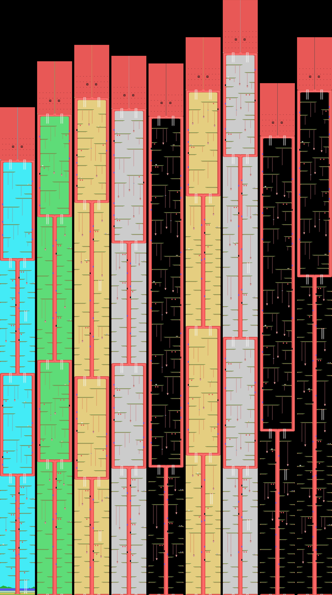

*The nine whole stages side by side, standing on the ground: they are climbed bottom to top. Each one, full size, in The game.*

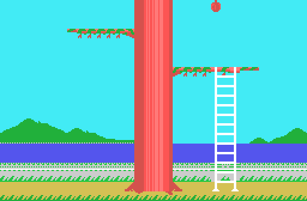

*Stage 1 at the start: its first screen, from the ROM's script and checked against openMSX down to 0 cells.*

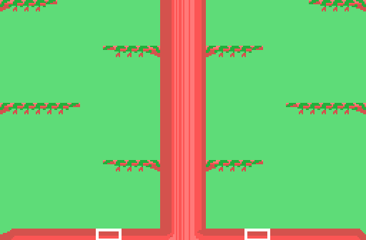

*Stage 2 at the start: its first screen, from the ROM's script and checked against openMSX down to 0 cells.*

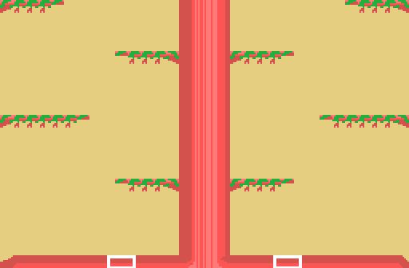

*Stage 3 at the start: its first screen, from the ROM's script and checked against openMSX down to 0 cells.*

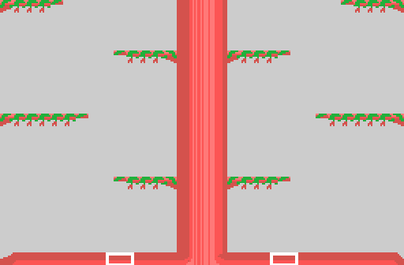

*Stage 4 at the start: its first screen, from the ROM's script and checked against openMSX down to 0 cells.*

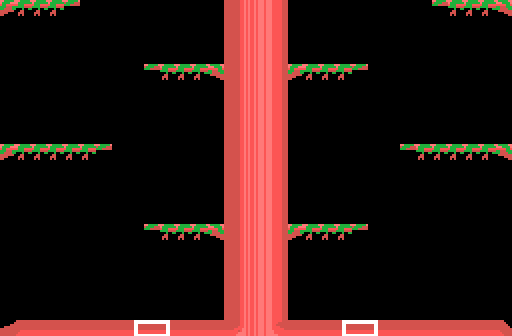

*Stage 5 at the start: its first screen, from the ROM's script and checked against openMSX down to 0 cells.*

*Stage 6 at the start: its first screen, from the ROM's script and checked against openMSX down to 0 cells.*

*Stage 7 at the start: its first screen, from the ROM's script and checked against openMSX down to 0 cells.*

*Stage 8 at the start: its first screen, from the ROM's script and checked against openMSX down to 0 cells.*

*Stage 9 at the start: its first screen, from the ROM's script and checked against openMSX down to 0 cells.*

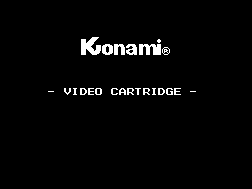

*The company screen, built from the ROM and checked down to 0 bytes.*

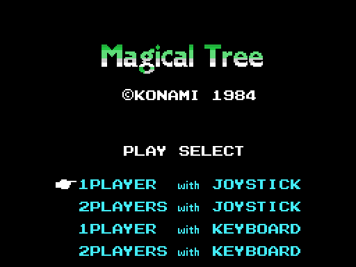

*The title screen, built the same way and checked down to 0 bytes.*

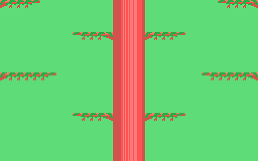

*The tree 0x7629 paints when the stage changes, from the middle outwards and in the colours of the stage that starts (here, stage 2). Checked down to 0 bytes.*

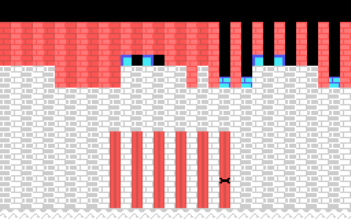

*The castle, after the ninth stage: its columns from the middle outwards, the windows at 0x7600 with the two characters and the sign. Checked down to 0 bytes.*

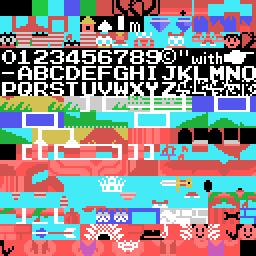

*The stage's patterns, with the first stage's colour mask.*

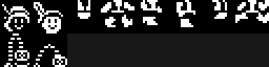

*The 16x16 sprites, from the ROM's blocks.*
