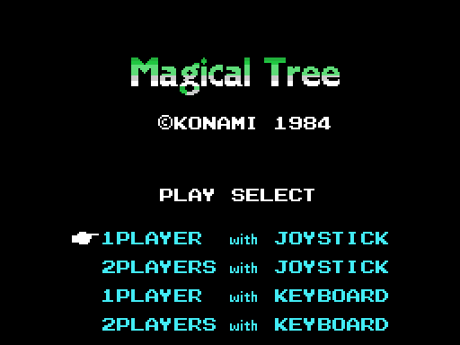

# Under the hood

## Getting started

This repository holds the commented disassembly of Konami's **Magical Tree**
for the MSX (RC-713, 1984). It does not hold the cartridge: the ROM image is
not distributed.

### What you need

- `pasmo` — the assembler that reproduces the ROM
- `python3` — the tools in `tools/`
- `make`
- Your own copy of the cartridge, in the root and named `magicaltree.rom`

It is **exactly 16,384 bytes** and its fingerprint is:

    sha256  a3f3ad0d8f5cda0f04bf917fbd9d796e9dc66d071bd30a2fde8d06260c7ec9f7

To check it:

    make comprueba

### Reproducing all of it

| command | what it does | what it proves |
|---|---|---|
| `make listado` | traces the flow and generates `src/magicaltree.asm` with the notes | that the listing comes from the cartridge and `src/magicaltree.notes`, not hand-edited |
| `make verify` | reassembles with `pasmo` and compares | that the listing IS the ROM, byte for byte |
| `make sanity` | splits the 16,384 bytes into code and data | that not one byte is left unassigned |
| `make test` | 39 tests | that the numbers on this site are the listing's |
| `make imagenes` | draws everything in `docs/imagenes/` from the ROM, the nine stages included | that the formats are read right |
| `make coteja_fases` | compares the nine stages with 156 openMSX dumps | zero cells different |
| `make coteja_decorados` | compares the between-stages tree and the castle with nine dumps | zero bytes different |

The check needs the dumps first: `tools/omsx_fases.tcl`, one stage per run,
with the number in `work/fase.txt`. See [In the emulator](UNDER-THE-HOOD.html).

## The cartridge

16 KB in page 1 (`0x4000-0x7FFF`), an `AB` header with INIT at `0x4077` and
no BASIC. The screen is SCREEN 2.

### VRAM, the other way round

The eight registers are loaded by `0x44EE` from `0x44FF`:
`02 E2 0E 7F 07 76 03 E1`. In SCREEN 2, R3 and R4 are base and mask, so
**the colour table is at `0x0000` and the patterns at `0x2000`**.

| area | what is there |
|---|---|
| `0x0000` | the colour table |
| `0x1800` | the sprite patterns |
| `0x2000` | the patterns |
| `0x3800` | the name table |
| `0x3B00` | the sprite attributes |
| `0x3B80` | **the stage script**: between 723 and 918 bytes |

### RAM

**The game's whole RAM is 1 KB**: `0xE000-0xE3FF`, cleared by INIT. The stack
is at `0xE400`.

| area | what is there |
|---|---|
| `0xE000` | the current scene |
| `0xE003` | the frame counter |
| `0xE005` | the interrupt lock, one bit |
| `0xE010` | the three sound voices, eleven bytes each |
| `0xE050` | the player in turn, 32 bytes; the other one at `0xE080` |
| `0xE051` | the stage number, in BCD |
| `0xE05C` / `0xE05D` | the stage counted from zero and its colour mask |
| `0xE0B0` | the sprite buffer |
| `0xE132` | the forty objects: row, column and type |
| `0xE1DE` | the three spiders, nine bytes each |

### The BIOS

It uses eight routines: RDVDP, RDVRM, SETRD, SETWRT, WRTVDP, WRTPSG, RDPSG and
SNSMAT.

### The two menu screens

Both are drawn from the ROM and checked against openMSX down to **0 bytes**.

## The code

### Everything in the interrupt

INIT (`0x4077`) sets interrupt mode 1, hooks H.KEYI with a jump to `0x402C`,
puts the stack at `0xE400`, clears the kilobyte of RAM and sits on the
`jr $` at `0x40A5`. Everything else happens in the hook, once per frame:
sound first, the controls, and the scene. The sixteen scenes are in the table
at `0x40C3`, stuck right behind the `call` of the dispatcher at `0x404A`,
which finds it with a `pop hl`.

The game frame (`0x51F5`) is eleven calls in a row, one for each thing that
moves.

### Climbing the tree

- `0x52BB` uploads the stage script to `0x3B80`.
- `0x6749` takes a step: it counts and, when it reaches the steps of the next
  entry, pulls it out into the forty objects at `0xE132`. Spiders (type
  `0xE0`) go to their three records at `0xE1DE`.
- `0x6889` moves each object eight pixels down, erases the row it leaves
  —only if its type does not have bit 7 set— and redraws it; `0x68F8` redraws
  on top the ones with bit 6, and `0x6C32` moves the spiders.
- `0x4A0E` picks the piece from one of four tables —46 pieces; the nine
  scripts use 35 types— and `0x49B8` draws it.
- `0x5363` takes twenty-six steps in a row to build the first screen.

### The screen is the map

There is no map in RAM. `0x61A3` reads the two cells under the player's feet
from VRAM and `0x6465` checks whether they are pattern `0x9B`. `0x6251` looks
for an object on the screen to erase it, and the creatures check the cell
ahead before moving: `0x6EB4` wants index 3, `0x7167` one between `0xCD` and
`0xD0`.

### Randomness

Nine `ld a,r`: the Z80's refresh counter.

### The tools

- `tools/arbol.py`: the script, the pieces and the scenery step; it draws the
  nine stages.
- `tools/graficos.py`: the stage VRAM and the menu screens, with the
  cartridge's set-up chain.
- `tools/guiones.py` and `tools/rle.py`: they measure the labels and the
  compressed blocks by running their interpreters.
- `tools/coteja_fases.py` and `tools/omsx_fases.tcl`: the check against
  openMSX.

## In the emulator

With openMSX and the `Philips_VG_8020` machine:

    echo 3 > work/fase.txt
    openmsx -machine Philips_VG_8020 -cart magicaltree.rom -script tools/omsx_fases.tcl

`tools/omsx_fases.tcl`:

- reads the stage from `work/fase.txt` (0 to 8) and writes it into `0xE05C`,
  `0xE05D` and `0xE051` at `0x51D2`, before the graphics are set up;
- dumps RAM and VRAM on the first game frame (`0x4184`), which is step 26;
- climbs the stage without playing it: stopped on the `jr $` at `0x40A5`, it
  runs `0x6749` thirty times from a piece of code at `0xE800`, with the hook
  replaced by a `ret` so that the game frame does not draw in between;
- dumps every thirty steps, up to the end of the stage, into `work/fases/`.

The whole game happens in the hook at `0x402C`: a breakpoint there stops once
per frame.

A warning: if a breakpoint's command fails, openMSX freezes the emulation. The
script wraps its commands in `catch` and logs the error in
`work/fases/log.txt`.

## Code shared with other Konami cartridges

This disassembly has been compared, instruction by instruction, with
every other Konami one in the series. A block counts when the same
instructions, at least six of them from a label to its `ret` or its
unconditional jump, are in both cartridges; the addresses are left
aside, because they change from one cartridge to the next. Of the
other 57, **44** have at least one block in common with this one;
these are the ones that share the most:

| Cartridge | Blocks | Instructions | For example (here = there) |
|---|---:|---:|---|
| [Circus Charlie](https://antxiko.github.io/CircusCharlie-disassembly/) | 41 | 565 | `atiende_el_menu` (0x4557) |
| [Cabbage Patch Kids](https://antxiko.github.io/CabbagePatchKids-disassembly/) | 25 | 298 | `lee_el_teclado` (0x4532) = `LEE_EL_TECLADO` |
| [Hyper Sports 1](https://antxiko.github.io/HyperSports1-disassembly/) | 25 | 341 | `atiende_el_menu` (0x4557) = `MANEJADOR_DEMO` |
| [Comic Bakery](https://antxiko.github.io/ComicBakery-disassembly/) | 21 | 351 | `atiende_el_menu` (0x4557) |
| [Konami’s Mahjong Dojo](https://antxiko.github.io/KonamisMahjongDojo-disassembly/) | 20 | 208 | `limpia_la_pantalla` (0x4422) = `limpia_la_pantalla_entera` |
| [Super Cobra](https://antxiko.github.io/SuperCobra-disassembly/) | 17 | 216 | `lee_la_nota_de_la_partitura` (0x7B7B) = `EL_VOLUMEN_DEL_EFECTO` |
| [Konami’s Billiards](https://antxiko.github.io/KonamisBilliards-disassembly/) | 9 | 116 | `pinta_el_marcador` (0x4343) = `refresca_el_marcador` |
| [Konami's Ping Pong](https://antxiko.github.io/KonamisPingPong-disassembly/) | 9 | 114 | `lee_el_teclado` (0x4532) = `lee_teclado_1` |
| [Athletic Land](https://antxiko.github.io/AthleticLand-disassembly/) | 8 | 85 | `pinta_el_numero_de_fase` (0x4385) = `PINTA_FASE` |
| [Hyper Sports 2](https://antxiko.github.io/HyperSports2-disassembly/) | 8 | 92 | `lee_el_teclado` (0x4532) = `LEE_EL_TECLADO` |

The whole matrix, the 58 cartridges against each other, is on
[The routines](https://antxiko.github.io/MSX-disassembly-database/THE-ROUTINES.html) in the series database, along
with the method and the program that measures it.
