# Lo que el cartucho dibuja

Debajo de cada imagen esta de donde sale y que se esta viendo. Las nueve fases enteras estan en El juego.

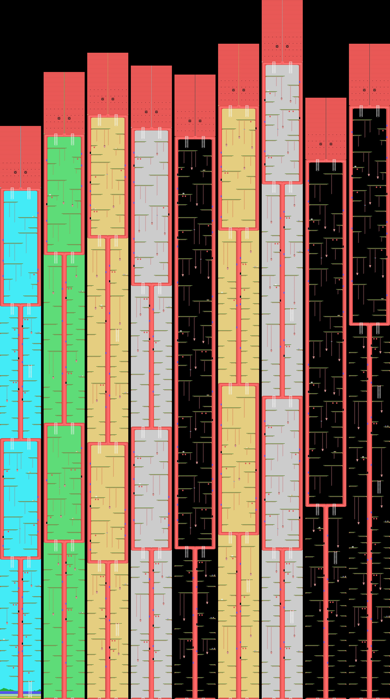

*Las nueve fases enteras, una al lado de otra y apoyadas en el suelo: de abajo arriba se suben. Cada una, a tamano completo, en El juego.*

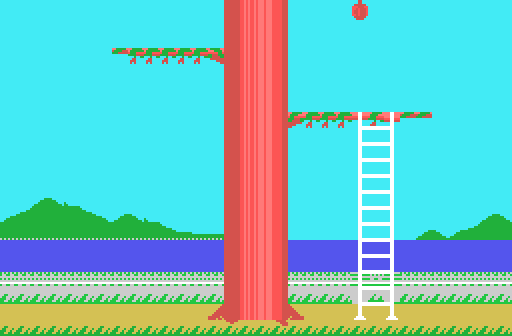

*La fase 1 al empezar: su primera pantalla, desde el guion de la ROM y cotejada contra openMSX a 0 celdas.*

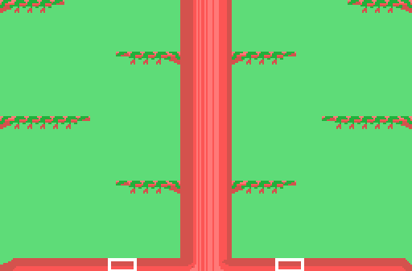

*La fase 2 al empezar: su primera pantalla, desde el guion de la ROM y cotejada contra openMSX a 0 celdas.*

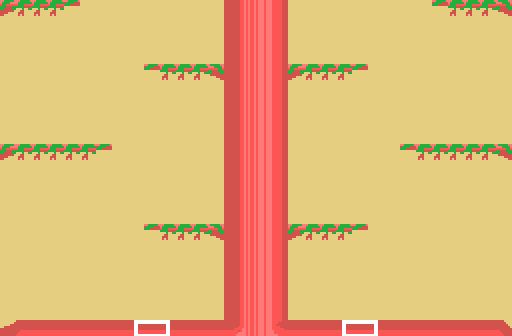

*La fase 3 al empezar: su primera pantalla, desde el guion de la ROM y cotejada contra openMSX a 0 celdas.*

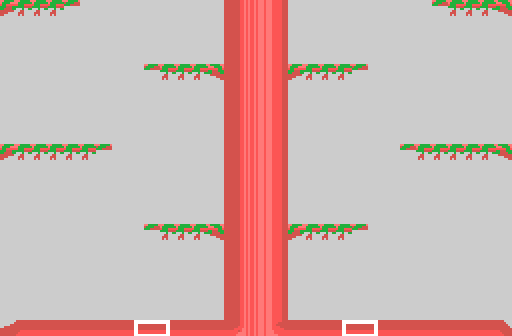

*La fase 4 al empezar: su primera pantalla, desde el guion de la ROM y cotejada contra openMSX a 0 celdas.*

*La fase 5 al empezar: su primera pantalla, desde el guion de la ROM y cotejada contra openMSX a 0 celdas.*

*La fase 6 al empezar: su primera pantalla, desde el guion de la ROM y cotejada contra openMSX a 0 celdas.*

*La fase 7 al empezar: su primera pantalla, desde el guion de la ROM y cotejada contra openMSX a 0 celdas.*

*La fase 8 al empezar: su primera pantalla, desde el guion de la ROM y cotejada contra openMSX a 0 celdas.*

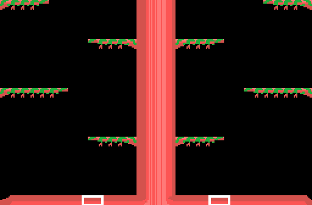

*La fase 9 al empezar: su primera pantalla, desde el guion de la ROM y cotejada contra openMSX a 0 celdas.*

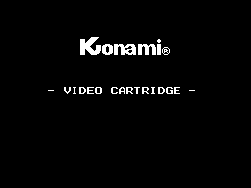

*La pantalla de la casa, montada desde la ROM y cotejada a 0 bytes.*

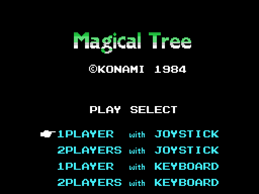

*La de titulo, montada igual y cotejada a 0 bytes.*

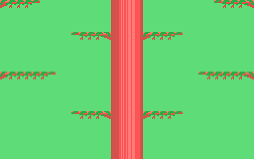

*El arbol que 0x7629 pinta al cambiar de fase, del centro hacia fuera y con los colores de la fase que empieza (aqui, la 2). Cotejado a 0 bytes.*

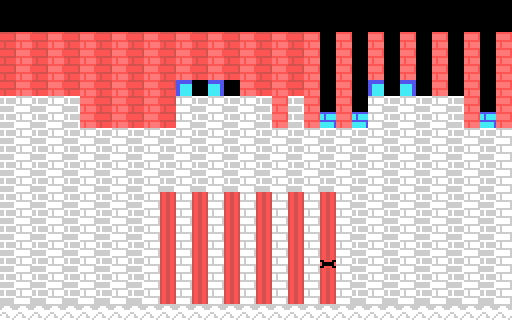

*El castillo, al acabar la novena: sus columnas del centro hacia fuera, las ventanas de 0x7600 con los dos personajes y el rotulo. Cotejado a 0 bytes.*

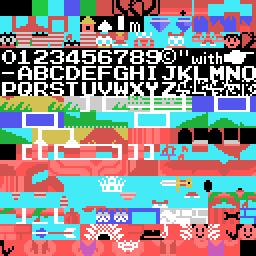

*Los patrones de la fase, con la mascara de color de la primera.*

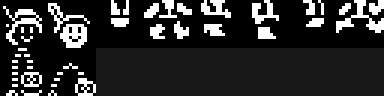

*Los sprites de 16x16, desde los bloques de la ROM.*
