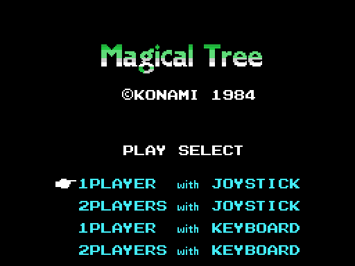

# Por dentro

## Empezar

Este repositorio contiene el desensamblado comentado de **Magical Tree** de
Konami para MSX (RC-713, 1984). No contiene el cartucho: la imagen de la ROM no
se distribuye.

### Lo que hace falta

- `pasmo` — el ensamblador que reproduce la ROM
- `python3` — las herramientas de `tools/`
- `make`
- Tu propia copia del cartucho, en la raíz y con el nombre `magicaltree.rom`

Son **16.384 bytes exactos** y su huella es:

    sha256  a3f3ad0d8f5cda0f04bf917fbd9d796e9dc66d071bd30a2fde8d06260c7ec9f7

Para comprobarla:

    make comprueba

### Reproducirlo entero

| orden | qué hace | qué demuestra |
|---|---|---|
| `make listado` | traza el flujo y genera `src/magicaltree.asm` con las notas | que el listado sale del cartucho y de `src/magicaltree.notes`, no se edita a mano |
| `make verify` | reensambla con `pasmo` y compara | que el listado ES la ROM, byte a byte |
| `make sanity` | reparte los 16.384 bytes entre código y datos | que no queda ni un byte sin asignar |
| `make test` | 39 tests | que las cifras de esta web son las del listado |
| `make imagenes` | dibuja todo lo de `docs/imagenes/` desde la ROM, las nueve fases incluidas | que los formatos están bien leídos |
| `make coteja_fases` | compara las nueve fases con 156 volcados de openMSX | cero celdas de diferencia |
| `make coteja_decorados` | compara el árbol de entre fases y el castillo con nueve volcados | cero bytes de diferencia |

El cotejo necesita antes los volcados: `tools/omsx_fases.tcl`, una fase por
arranque, con el número en `work/fase.txt`. Ver [En el emulador](POR-DENTRO.html).

## El cartucho

16 KB en la página 1 (`0x4000-0x7FFF`), cabecera `AB` con INIT en `0x4077` y
sin BASIC. Pantalla en SCREEN 2.

### La VRAM, al revés de lo habitual

Los ocho registros los baja `0x44EE` desde `0x44FF`: `02 E2 0E 7F 07 76 03 E1`.
En SCREEN 2, R3 y R4 son base y máscara, así que **el color va en `0x0000` y
los patrones en `0x2000`**.

| zona | qué hay |
|---|---|
| `0x0000` | la tabla de color |
| `0x1800` | los patrones de sprite |
| `0x2000` | los patrones |
| `0x3800` | la tabla de nombres |
| `0x3B00` | los atributos de los sprites |
| `0x3B80` | **el guion de la fase**: entre 723 y 918 bytes |

### La RAM

**Toda la RAM del juego es 1 KB**: `0xE000-0xE3FF`, puesta a cero por INIT. La
pila, en `0xE400`.

| zona | qué hay |
|---|---|
| `0xE000` | la escena en curso |
| `0xE003` | el contador de cuadros |
| `0xE005` | el cerrojo de la interrupción, de un bit |
| `0xE010` | las tres voces del sonido, once bytes cada una |
| `0xE050` | el jugador en turno, 32 bytes; el otro, en `0xE080` |
| `0xE051` | el número de fase, en BCD |
| `0xE05C` / `0xE05D` | la fase contada desde cero y su máscara de color |
| `0xE0B0` | el búfer de los sprites |
| `0xE132` | los cuarenta objetos: fila, columna y tipo |
| `0xE1DE` | las tres arañas, nueve bytes cada una |

### La BIOS

Usa ocho rutinas: RDVDP, RDVRM, SETRD, SETWRT, WRTVDP, WRTPSG, RDPSG y SNSMAT.

### Las dos pantallas de menú

Están dibujadas desde la ROM y cotejadas contra openMSX a **0 bytes**.

## El código

### Todo en la interrupción

INIT (`0x4077`) pone el modo 1 de interrupción, engancha H.KEYI con un salto a
`0x402C`, deja la pila en `0xE400`, pone a cero el kilobyte de RAM y se queda
en el `jr $` de `0x40A5`. Lo demás pasa en el gancho, una vez por cuadro: el
sonido primero, los mandos, y la escena. Las dieciséis escenas están en la
tabla de `0x40C3`, pegada detrás del `call` del despachador de `0x404A`, que la
encuentra con un `pop hl`.

El cuadro de la partida (`0x51F5`) son once llamadas seguidas, una por cada
cosa que se mueve.

### Subir el árbol

- `0x52BB` sube el guion de la fase a `0x3B80`.
- `0x6749` da un paso: cuenta y, cuando llega a los pasos de la siguiente
  entrada, la saca a los cuarenta objetos de `0xE132`. Las arañas (tipo
  `0xE0`) van a sus tres fichas de `0xE1DE`.
- `0x6889` baja cada objeto ocho píxeles, borra la fila que deja —solo si el
  tipo no lleva el bit 7— y lo repinta; `0x68F8` repinta encima los que llevan
  el bit 6, y `0x6C32` corre las arañas.
- `0x4A0E` elige la pieza en una de cuatro tablas —46 piezas; los nueve
  guiones usan 35 tipos— y `0x49B8` la pinta.
- `0x5363` da veintiséis pasos seguidos para montar la primera pantalla.

### La pantalla es el mapa

No hay mapa en RAM. `0x61A3` lee de la VRAM las dos celdas bajo los pies del
jugador y `0x6465` mira si son el patrón `0x9B`. `0x6251` busca un objeto en la
pantalla para borrarlo, y los bichos miran la celda de delante antes de
avanzar: `0x6EB4` quiere el índice 3, `0x7167` uno entre `0xCD` y `0xD0`.

### El azar

Nueve `ld a,r`: el contador de refresco del Z80.

### Las herramientas

- `tools/arbol.py`: el guion, las piezas y el paso del decorado; dibuja las
  nueve fases.
- `tools/graficos.py`: la VRAM de la fase y las pantallas de menú, con la
  cadena de montaje del cartucho.
- `tools/guiones.py` y `tools/rle.py`: miden los rótulos y los bloques
  comprimidos ejecutando sus intérpretes.
- `tools/coteja_fases.py` y `tools/omsx_fases.tcl`: el cotejo contra openMSX.

## En el emulador

Con openMSX y la máquina `Philips_VG_8020`:

    echo 3 > work/fase.txt
    openmsx -machine Philips_VG_8020 -cart magicaltree.rom -script tools/omsx_fases.tcl

`tools/omsx_fases.tcl`:

- lee la fase de `work/fase.txt` (0 a 8) y la escribe en `0xE05C`, `0xE05D` y
  `0xE051` en `0x51D2`, antes de que se monten los gráficos;
- vuelca RAM y VRAM en el primer cuadro de partida (`0x4184`), que es el
  paso 26;
- sube la fase sin jugarla: parado en el `jr $` de `0x40A5`, ejecuta treinta
  veces `0x6749` desde un trozo de código en `0xE800`, con el gancho cambiado
  por un `ret` para que el cuadro de partida no pinte en medio;
- vuelca cada treinta pasos, hasta el final de la fase, en `work/fases/`.

Todo el juego pasa en el gancho de `0x402C`: un punto de ruptura ahí para una
vez por cuadro.

Un aviso: si la orden de un punto de ruptura falla, openMSX congela la
emulación. El guion envuelve las suyas en `catch` y apunta el error en
`work/fases/log.txt`.

## Código compartido con otros cartuchos de Konami

Este desensamblado se ha comparado, instrucción por instrucción, con
todos los demás de Konami de la serie. Cuenta un bloque cuando las
mismas instrucciones, al menos seis desde una etiqueta hasta su `ret`
o su salto sin condición, están en los dos cartuchos; las direcciones
no se miran, porque cambian de un cartucho a otro. De los otros 57,
**44** tienen al menos un bloque en común con este; estos son los
que más comparten:

| Cartucho | Bloques | Instrucciones | Por ejemplo (aquí = allí) |
|---|---:|---:|---|
| [Circus Charlie](https://antxiko.github.io/CircusCharlie-disassembly/es/) | 41 | 565 | `atiende_el_menu` (0x4557) |
| [Cabbage Patch Kids](https://antxiko.github.io/CabbagePatchKids-disassembly/es/) | 25 | 298 | `lee_el_teclado` (0x4532) = `LEE_EL_TECLADO` |
| [Hyper Sports 1](https://antxiko.github.io/HyperSports1-disassembly/es/) | 25 | 341 | `atiende_el_menu` (0x4557) = `MANEJADOR_DEMO` |
| [Comic Bakery](https://antxiko.github.io/ComicBakery-disassembly/es/) | 21 | 351 | `atiende_el_menu` (0x4557) |
| [Konami’s Mahjong Dojo](https://antxiko.github.io/KonamisMahjongDojo-disassembly/es/) | 20 | 208 | `limpia_la_pantalla` (0x4422) = `limpia_la_pantalla_entera` |
| [Super Cobra](https://antxiko.github.io/SuperCobra-disassembly/es/) | 17 | 216 | `lee_la_nota_de_la_partitura` (0x7B7B) = `EL_VOLUMEN_DEL_EFECTO` |
| [Konami’s Billiards](https://antxiko.github.io/KonamisBilliards-disassembly/es/) | 9 | 116 | `pinta_el_marcador` (0x4343) = `refresca_el_marcador` |
| [Konami's Ping Pong](https://antxiko.github.io/KonamisPingPong-disassembly/es/) | 9 | 114 | `lee_el_teclado` (0x4532) = `lee_teclado_1` |
| [Athletic Land](https://antxiko.github.io/AthleticLand-disassembly/es/) | 8 | 85 | `pinta_el_numero_de_fase` (0x4385) = `PINTA_FASE` |
| [Hyper Sports 2](https://antxiko.github.io/HyperSports2-disassembly/es/) | 8 | 92 | `lee_el_teclado` (0x4532) = `LEE_EL_TECLADO` |

La matriz entera, los 58 cartuchos entre sí, está en
[Las rutinas](https://antxiko.github.io/MSX-disassembly-database/es/LAS-RUTINAS.html) de la base de datos de la
serie, con el método y el programa que la mide.
